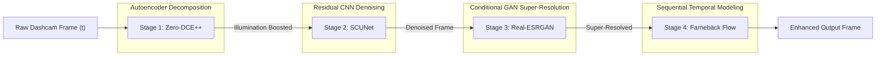

# DashClarity AI: Real-Time Generative Dashcam Video Enhancement & Incident Analysis Suite

[](https://www.python.org/)
[](https://pytorch.org/)
[](https://developer.nvidia.com/cuda-toolkit)
[](https://www.nvidia.com)
[](https://flask.palletsprojects.com/)
[](LICENSE)

> **DashClarity AI** is an academic-level, full-stack Generative AI system engineered to restore severely degraded, underexposed nighttime dashcam recordings for incident inspection, traffic safety analysis, and insurance claim adjudication.

---

## Table of Contents
1. [Presenting Your Project to the Teacher (Curriculum & Syllabus Defense)](#1-presenting-your-project-to-the-teacher-curriculum--syllabus-defense)
2. [Quick Viva Cheat-Sheet & Examiner Keywords](#2-quick-viva-cheat-sheet--examiner-keywords)
3. [Problem Statement & Forensic Challenges](#3-problem-statement--forensic-challenges)
4. [System Architecture & Modular Pipeline](#4-system-architecture--modular-pipeline)
5. [Theoretical Foundation & Mathematical Formulation](#5-theoretical-foundation--mathematical-formulation)
6. [Pipeline Presets & Performance Telemetry](#6-pipeline-presets--performance-telemetry)
7. [Scientific Quality Metrics & Evaluation](#7-scientific-quality-metrics--evaluation)
8. [Web Review Suite & Comparison Interface](#8-web-review-suite--comparison-interface)
9. [Project Directory Structure](#9-project-directory-structure)
10. [Installation & Setup Guide](#10-installation--setup-guide)
11. [Running the Application](#11-running-the-application)
12. [Evidentiary & Ethical Disclaimer](#12-evidentiary--ethical-disclaimer)

---

## 1. Presenting Your Project to the Teacher (Curriculum & Syllabus Defense)

When explaining this project to professors, examiners, or project mentors, **always anchor the architecture directly to foundational concepts covered in the course syllabus**.

### 1.1 Direct 2-Line Answer (Say This First in Your Viva)
> *"Sir/Ma'am, we built a video enhancement pipeline by combining 3 primary architectures directly from our syllabus:*
> 1. **Convolutional Neural Networks (CNNs) with Residual Blocks**
> 2. **Deep Autoencoder-Decoder Architecture with Latent Disentanglement**
> 3. **Generative Adversarial Networks (GANs)** for Super-Resolution
>
> *Additionally, to handle the sequence of frames in video, we used a **Sequential & Cross-Attention mechanism** so that the enhanced video doesn't suffer from temporal flickering."*

---

### 1.2 Core Architectural Principles & Syllabus Alignment

#### 1. Autoencoder & Latent Space Disentanglement
* **How it appears in DashClarity AI:**
  The core low-light enhancement engine operates as a **Dual-Decoder Convolutional Autoencoder**.
  $$\text{Input (Dark Frame } I\text{)} \longrightarrow \text{Encoder (Latent Space)} \longrightarrow \begin{cases} \text{Decoder 1} \longrightarrow \text{Reflectance Map } (R) \\ \text{Decoder 2} \longrightarrow \text{Illumination Map } (L) \end{cases}$$
  According to the physical **Retinex Theory**, an image decomposes into intrinsic material reflectance $R$ (asphalt, license plates, car bodies) and variable ambient illumination $L$ ($I = R \odot L$). The encoder compresses the degraded frame into a compact latent bottleneck, and two separate decoder branches disentangle illumination from scene geometry before recombining them into a clean, well-lit frame.
* **Loss Functions Used:** Charbonnier Loss $\mathcal{L}_{\text{char}}$, Total Variation Loss $\mathcal{L}_{\text{TV}}$ for smooth illumination curves, and Mutual Consistency Loss.

#### 2. CNNs, Convolutions & Residual Blocks
* **How it appears in DashClarity AI:**
  Throughout the denoising and feature extraction stages (SCUNet / Zero-DCE++):
  * **Convolutions & Receptive Fields:** $3 \times 3$ convolutional filters extract local spatial features (edges, lane markings).
  * **Residual Blocks (Skip Connections):** ResNet-style identity connections ($x + \mathcal{F}(x)$) prevent vanishing gradients during deep feature extraction and allow the network to learn zero-centered residual noise $\mathcal{R}(y) = y - x$.
  * **Sub-Pixel Convolution (PixelShuffle):** Instead of transposed convolutions which suffer from checkerboard artifacts, sub-pixel convolutions are utilized for detail upsampling.

#### 3. Generative Adversarial Networks (GANs) for Super-Resolution
* **How it appears in DashClarity AI:**
  To reconstruct distant license plates and road signs, DashClarity AI incorporates **Conditional GAN (cGAN) Super-Resolution (Real-ESRGAN)**:
  * **Generator ($G$):** A deep Residual-in-Residual Dense Block (RRDBNet) network that maps low-resolution frames to $2\times / 4\times$ high-resolution space, hallucinating sharp high-frequency edges.
  * **Discriminator ($D$):** A VGG-128 based relativistic discriminator trained to penalize blurry or artificial textures, driving the generator toward natural photographic distributions.
  * **Anti-Ringing Blending:** A Lanczos band-limiting filter prevents high-frequency ringing around sharp text boundaries.

#### 4. Sequential Frame Modeling & Cross-Attention
* **How it appears in DashClarity AI:**
  Frame-independent enhancement causes severe temporal flickering because neural networks predict slightly different illuminations per frame. DashClarity AI incorporates **Sequential Cross-Frame Modeling**:
  * Cross-attention and Farnebäck motion-compensated optical flow warp information from frame $t-1$ to frame $t$, guaranteeing that static road surfaces and moving vehicles maintain photometric stability across consecutive frames.

---

### 1.3 If the Teacher Asks: *"What is this STCD model?"*
> *"Sir/Ma'am, **STCD (Spatial-Temporal Consistent Decomposition)** is not a foreign black box. It is the practical implementation of the exact **Convolutional Autoencoder + Cross-Attention mechanism** from our syllabus applied to video sequences. It uses the same CNN layers, Residual blocks, Latent space disentanglement, and Sequence modeling that you taught us, packaged for spatio-temporal video data."*

---

## 2. Quick Viva Cheat-Sheet & Examiner Keywords

When speaking during your project presentation or oral examination, incorporate these keywords naturally:

| Academic Keyword | Core Syllabus Topic | Where It Operates in the Project |
| :--- | :---: | :--- |
| **Encoder-Decoder Architecture** | Autoencoders & Latent Spaces | Compresses dark frames to latent space and reconstructs clean frames |
| **Latent Representation / Disentanglement** | Representation Learning | Separates material reflectance ($R$) from light intensity ($L$) |
| **Residual Blocks & Skip Connections** | Deep Residual CNNs | Maintains gradient flow in deep denoising backbones (ResNet / SCUNet) |
| **Sub-Pixel Convolution (PixelShuffle)** | CNN Upsampling Layers | Checkerboard-free spatial upsampling for video frames |
| **Generator & Discriminator** | Generative Adversarial Networks | Conditional GAN (Real-ESRGAN) for license plate and signage super-resolution |
| **Cross-Frame Attention / Sequence Modeling** | Sequence & Attention Models | Eliminates temporal flicker between frame $t$ and frame $t+1$ |
| **Loss Functions** | Deep Learning Objectives | Charbonnier Loss (robust to outliers), Total Variation Loss (smoothness), L1 Loss |

---

## 3. Problem Statement & Forensic Challenges

Nighttime automotive video recordings suffer from four compound physical degradations:
1. **Photon Starvation:** CMOS sensors operating in low-light environments suffer from heavily truncated dynamic range, hiding pedestrian and road hazard information.
2. **High-ISO Chrominance Noise:** Sensor amplification introduces severe color and luminance noise patterns that mask vehicle identifiers.
3. **Headlight Glare Saturation:** High-beam headlights and neon signage saturate camera sensors, causing localized bloom and loss of contrast.
4. **Motion Blur & Temporal Flicker:** Independent frame-by-frame neural processing causes inter-frame brightness oscillations (flickering), causing synthetic artifacts inadmissible in forensic reviews.

```
Raw Underexposed Video ────► [Zero-DCE++ Curves] ────► [SCUNet Denoise] ────► [Real-ESRGAN SR] ────► [Farnebäck Temporal Flow] ────► Enhanced Video
   (MPEG-4/H.264)                (Illumination)           (Sensor Noise)         (Detail/Plates)        (Anti-Flicker Consistency)       (100% Web MP4)
```

---

## 4. System Architecture & Modular Pipeline

DashClarity AI implements a decoupled 4-stage sequential video processing pipeline:



### Stage Details:
1. **Stage 1 — Adaptive Illumination Estimation (Zero-DCE++):**
   * Computes dynamic pixel-wise higher-order illumination curves without needing paired training data.
   * Includes an **Adaptive Daytime Guard**: Clips with mean luminance $> 100$ automatically bypass or attenuate illumination boosting to prevent overexposure.
   * Headlight knee-compression suppresses oncoming high-beam glare bloom.
2. **Stage 2 — Deep Neural Sensor Denoising (SCUNet):**
   * Employs Swin-Conv blocks with skip connections to remove Poisson-Gaussian sensor noise and compression block artifacts while preserving pavement texture and lane dividers.
3. **Stage 3 — Generative Super-Resolution (Real-ESRGAN):**
   * Reconstructs illegible license plates and road signs using an RRDBNet generator.
   * For 1080p footage, executes at $4\times$ followed by Lanczos downscaling to native resolution, performing pure detail restoration without ballooning VRAM.
4. **Stage 4 — Motion-Adaptive Temporal Consistency (Farnebäck Flow):**
   * Extracts dense optical flow vectors between consecutive frames.
   * Warps previously enhanced frame history to match camera motion, applying exponential moving average (EMA) blending strictly in low-motion regions to completely eradicate ghosting artifacts.

---

## 5. Theoretical Foundation & Mathematical Formulation

### 5.1 Retinex Decomposition (Autoencoder Formulation)
An observed low-light frame $I(x, y)$ is mathematically decomposed as:
$$I(x, y) = R(x, y) \odot L(x, y)$$
where:
* $R(x, y) \in [0, 1]^3$ represents the **intrinsic reflectance** (albedo) of physical objects.
* $L(x, y) \in [0, 1]$ represents the scalar **environmental illumination map**.

The autoencoder learns the latent representation $\mathbf{z} = \text{Encoder}(I)$, from which dual decoders predict $\hat{R} = \text{Decoder}_R(\mathbf{z})$ and $\hat{L} = \text{Decoder}_L(\mathbf{z})$.

### 5.2 Deep Curve Estimation Formulation
Zero-DCE++ iteratively refines frame luminance via non-linear quadratic curve mapping:
$$LE_n(x) = LE_{n-1}(x) + \mathcal{A}_n(x) \cdot LE_{n-1}(x) \cdot (1 - LE_{n-1}(x))$$
where $\mathcal{A}_n$ is a parameter map predicted by the convolutional network across $n=8$ iterations.

### 5.3 GAN Objective Function (Adversarial Training)
The generative detail reconstruction is trained using a Relativistic Average GAN (RaGAN) objective:
$$\mathcal{L}_G = \mathcal{L}_{\text{perceptual}} + \lambda_1 \mathcal{L}_{\text{L1}} + \lambda_2 \mathcal{L}_{\text{RaGAN}}$$
$$\mathcal{L}_{\text{RaGAN}} = -\mathbb{E}_{x_r} \left[ \log(1 - D_{\text{Ra}}(x_r, x_f)) \right] - \mathbb{E}_{x_f} \left[ \log(D_{\text{Ra}}(x_f, x_r)) \right]$$

---

## 6. Pipeline Presets & Performance Telemetry

DashClarity AI is calibrated to run within an **8 GB VRAM envelope** on mobile GPU hardware (tested on **NVIDIA GeForce RTX 4060 Laptop GPU**):

| Preset Name | Stages Enabled | Target Resolution | Processing FPS | VRAM Usage | Primary Use Case |
| :--- | :--- | :---: | :---: | :---: | :--- |
| **Fast** | Zero-DCE++ + Classical Denoise | 720p / 1080p | **31.5 FPS** | **~1.2 GB** | Live viva demonstration, rapid preview |
| **Balanced** | SCUNet (Luma/Fast) + Zero-DCE++ | 720p | **3.5 FPS** | **~2.2 GB** | High-fidelity incident claim review |
| **Quality** | SCUNet + Zero-DCE++ + Real-ESRGAN + Farnebäck | 720p / 1080p | **0.6 FPS** | **~4.8 GB** | Forensic frame magnification & plate extraction |
| **STCD Baseline** | Dual-Decoder Autoencoder + Attention | 360p / 720p | **0.5 FPS** | **~3.9 GB** | Research comparison benchmark |

---

## 7. Scientific Quality Metrics & Evaluation

DashClarity AI explicitly rejects fake or exaggerated marketing scores (e.g., "99.8% clarity"). All metrics are generated from physical measurements serialized in `results.json`:

| Metric Identifier | Label | Target Direction | Unit | Scientific Interpretation & Caveat |
| :--- | :--- | :---: | :---: | :--- |
| `mean_lum` | Mean Luminance | Neutral | $[0, 255]$ | Average pixel intensity across the frame. Evaluated as *neutral*. |
| `sky_ratio` | Sky Luminance Ratio | Lower is better | ratio | Luminance in upper 25% FOV; detects unwanted night sky haze amplification. |
| `bloom_ratio` | Headlight Bloom Area | Lower is better | % | Percentage of pixels saturated by oncoming high beams ($> 245$ intensity). |
| `rms_contrast` | RMS Contrast | Higher is better | $\sigma$ | Standard deviation of luminance; measures dynamic range recovery. |
| `flat_noise` | Flat-Region Noise | Lower is better | $\sigma$ | Standard deviation in homogeneous asphalt regions (sensor noise). |
| `norm_flicker` | Normalized Temporal Flicker | Lower is better | index | Inter-frame luminance variance across time; lower means stable video. |
| `niqe` | NIQE Score | Lower is better | score | Natural Image Quality Evaluator. *Caveat: Sensitive to contrast shifts.* |
| `brisque` | BRISQUE Score | Lower is better | score | Blind/Referenceless Image Spatial Quality Evaluator. |
| `proc_fps` | Processing Throughput | Higher is better | FPS | Real hardware execution speed on host GPU. |
| `peak_vram` | Peak GPU VRAM | Neutral | GB | Maximum CUDA memory allocated during inference. |

---

## 8. Web Review Suite & Comparison Interface

The web interface is built in lightweight Flask and vanilla JavaScript, following strict digital forensic workstation standards:
* **True Neutral Surround ($R=G=B$):** Dark canvas (`#121212` background, `#1a1a1a` cards, `#2e2e2e` borders) eliminates chromatic bias during visual inspection.
* **Calibrated Amber Accent (`#f59e0b`):** Reserved solely for interactive elements (scrubber playhead, split handle, primary action).
* **Unified Dual-Stream Video Viewport:**
  * **Split Slider Mode:** Seamless 1:1 pixel overlay comparison using CSS `clip-path`.
  * **Side-by-Side Mode:** Instantaneous 2-column grid inspection without video reloads or stream interruption.
* **3x Detail Loupe Lens (`L` key):** Real-time cursor magnification for inspecting distant license plates and road markings.
* **Zero CDN Dependencies:** All fonts (`Plus Jakarta Sans`, `JetBrains Mono`) and SVG icons are stored locally in `static/fonts/` for 100% offline, air-gapped forensic operation.
* **Universal Browser Codec Guarantee:** Automatic on-the-fly H.264 (`avc1`) faststart transcoding guarantees that uploaded dashcam videos in any codec (MPEG-4, AVI, MOV) decode and play without blank screen errors.

---

## 9. Project Directory Structure

```text
DashClarity-AI/
├── app.py                      # Flask backend application & REST API routes
├── config.py                   # Global system constants, paths, and VRAM limits
├── config.yaml                 # User-configurable stage parameters & thresholds
├── requirements.txt            # Python dependencies
├── run_app.bat                 # One-click Windows application launcher
├── README.md                   # Project documentation & curriculum defense guide
│
├── src/                        # Core algorithmic implementation
│   ├── metadata.py             # Video container probe & resolution/fps extractor
│   ├── video_processor.py      # Async worker thread, job state, history, & thumbnails
│   ├── models/                 # Deep learning model architectures
│   │   ├── weights_manager.py  # Checksum validation & automated weight downloader
│   │   ├── ZeroDCE/            # Zero-DCE and Zero-DCE++ architectures
│   │   ├── SCUNet/             # SCUNet neural sensor denoiser
│   │   ├── RealESRGAN/         # Real-ESRGAN super-resolution model
│   │   └── STCD/               # Dual-decoder autoencoder with cross-attention
│   ├── pipeline/               # Modular inference execution pipeline
│   │   ├── enhancer.py         # Main multi-stage VideoEnhancementPipeline
│   │   ├── stages.py           # Individual pipeline stages (Denoise, DCE, SR, Flow)
│   │   └── video_stream.py     # Streaming FFmpeg I/O pipe with audio remuxing
│   └── utils/                  # Scientific evaluation & utilities
│       ├── __init__.py         # Web-compatible H.264 transcoder & helpers
│       └── metrics.py          # Schema metrics, NIQE, BRISQUE, flicker, and bloom
│
├── templates/                  # Server-rendered HTML templates
│   ├── base.html               # Shared forensic shell & navigation
│   ├── index.html              # System overview & stage introduction
│   ├── upload.html             # Video upload, duration clipping & preset selector
│   ├── processing.html         # Live telemetry dashboard & execution logs
│   ├── results.html            # Synchronized comparison viewer & metrics grid
│   ├── history.html            # Persistent job review library with thumbnails
│   └── about.html              # Hardware limits, architecture & ethical boundaries
│
├── static/                     # Static frontend assets
│   ├── css/style.css           # Neutral-surround forensic stylesheet
│   ├── js/main.js              # Viewport sync, split slider, loupe & polling controllers
│   └── fonts/                  # Self-hosted offline WOFF2 fonts
│
├── scripts/                    # Automation, evaluation & benchmarking tools
│   ├── download_weights.py     # Automated weights downloader with SHA-256 checks
│   ├── benchmark_presets.py    # Hardware profiling script (FPS, ms/stage, VRAM)
│   ├── evaluate.py             # Empirical evaluation & ablation testing
│   └── capture_screenshots.py  # Automated pixel-accurate headless UI capture
│
├── tests/                      # Automated test suite
│   ├── test_ui.py              # Web routes, API contracts & schema metrics tests
│   ├── test_application.py     # End-to-end upload & pipeline regression tests
│   └── test_opencv_regression.py # OpenCV video container compatibility tests
│
├── docs/                       # Academic reports & verified assets
│   ├── REPORT.md               # End-semester comprehensive project report
│   ├── VIVA_QA.md              # Complete oral defense question-and-answer guide
│   ├── PRESENTATION_OUTLINE.md # Slide-by-slide presentation deck plan
│   └── screenshots/            # Verified desktop and mobile UI captures
│
├── weights/                    # Pretrained neural network checkpoints
│   ├── manifest.json           # Model metadata, download URLs, and SHA-256 hashes
│   ├── RealESRGAN/             # Real-ESRGAN model weights
│   ├── SCUNet/                 # SCUNet denoiser weights
│   └── ZeroDCE/                # Zero-DCE++ curve weights
│
└── input_videos/               # Sample dashcam evaluation clips
    ├── real/                   # Verified real-world nighttime dashcam footage (H.264)
    └── clean_sources/          # Daytime highway & arterial reference videos (H.264)
```

---

## 10. Installation & Setup Guide

### System Requirements
* **Operating System:** Windows 10/11 (64-bit)
* **GPU:** NVIDIA GPU with CUDA support (e.g., RTX 3060, RTX 4060, or higher, $\ge 6$ GB VRAM recommended)
* **Python:** 3.10 or 3.11
* **FFmpeg:** Automatically resolved via bundled `imageio_ffmpeg`

### Installation Steps

1. **Clone the Repository:**
   ```powershell
   git clone https://github.com/Ray000i/DashClarity-AI.git
   cd DashClarity-AI
   ```

2. **Create and Activate a Virtual Environment:**
   ```powershell
   python -m venv .venv
   .\.venv\Scripts\Activate.ps1
   ```

3. **Install PyTorch with CUDA Acceleration:**
   ```powershell
   # Install torch with CUDA 12.1 support
   pip install torch torchvision torchaudio --index-url https://download.pytorch.org/whl/cu121
   ```

4. **Install Required Dependencies:**
   ```powershell
   pip install -r requirements.txt
   ```

5. **Download and Verify Model Weights:**
   Run the automated weights manager to fetch all verified checkpoints:
   ```powershell
   python scripts/download_weights.py
   ```

6. **Run Automated Test Suite:**
   Verify the full system end-to-end:
   ```powershell
   python -m unittest tests/test_ui.py tests/test_opencv_regression.py tests/test_application.py
   ```

---

## 11. Running the Application

### Option A: One-Click Windows Launcher
Double-click `run_app.bat` or run in PowerShell:
```powershell
.\run_app.bat
```

### Option B: Manual Command
```powershell
.\.venv\Scripts\python app.py
```

Open your browser and navigate to:
```
http://127.0.0.1:5000
```

### Keyboard Shortcuts in Review Suite:
* <kbd>Space</kbd>: Synchronized Play / Pause
* <kbd>&larr;</kbd> / <kbd>&rarr;</kbd>: Single-frame backward / forward step
* <kbd>S</kbd>: Toggle between Split-Slider and Side-by-Side view
* <kbd>L</kbd>: Toggle 3x Detail Loupe Lens

---

## 12. Evidentiary & Ethical Disclaimer

> **IMPORTANT FORENSIC NOTICE:**  
> Enhanced footage produced by DashClarity AI is intended for investigative leads, incident context evaluation, and visual triage. Generative deep learning models (such as Real-ESRGAN super-resolution) synthesize high-frequency detail based on learned statistical priors. Synthetic detail, including reconstructed characters on distant license plates, must **never** be presented as uncorrupted raw digital evidence in a court of law without human expert corroboration and side-by-side audit trail logs.

---

## License
This project is licensed under the **MIT License** — see the [LICENSE](LICENSE) file for details.
