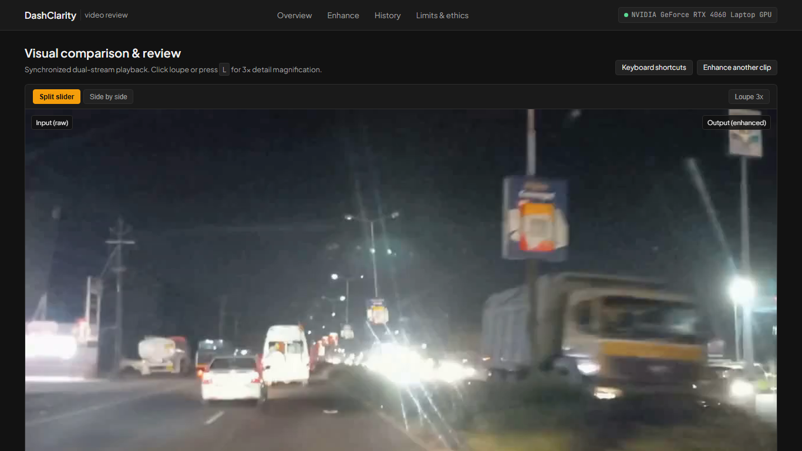
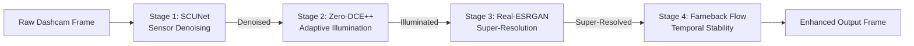

# DashClarity AI: Real-Time Generative Dashcam Video Enhancement Suite

[](https://www.python.org/)
[](https://pytorch.org/)
[](https://developer.nvidia.com/cuda-toolkit)
[](https://www.nvidia.com)
[](https://flask.palletsprojects.com/)
[](LICENSE)

> **DashClarity AI** is an end-to-end, deep learning-powered video restoration and analysis platform engineered to restore severely degraded, underexposed, and noisy nighttime dashcam recordings for incident inspection, forensic review, and autonomous perception.

---

## Visual Comparison & Web Review Suite



*Figure 1: Dual-stream synchronized review suite featuring 1:1 split-slider overlay, side-by-side mode, interactive 3x detail loupe lens, and scientific telemetry.*

---

## Table of Contents
1. [Key Features](#key-features)
2. [System Architecture & Deep Learning Pipeline](#system-architecture--deep-learning-pipeline)
3. [Core Technologies & Machine Learning Pipeline](#core-technologies--machine-learning-pipeline)
4. [Performance Telemetry & Presets](#performance-telemetry--presets)
5. [Scientific Evaluation & Metrics](#scientific-evaluation--metrics)
6. [Repository Directory Structure](#repository-directory-structure)
7. [Installation & Setup](#installation--setup)
8. [Running the Application](#running-the-application)
9. [Evidentiary & Forensic Disclaimer](#evidentiary--forensic-disclaimer)
10. [License](#license)

---

## Key Features

- 🌙 **Adaptive Curve Illumination (Zero-DCE++):** Estimates dynamic pixel-wise higher-order illumination curves without paired training data. Features an adaptive daytime exposure guard and headlight glare knee-compression.
- 🛡️ **Deep Neural Sensor Denoising (SCUNet):** Leverages a Swin-Conv architecture with residual skip connections to eliminate Poisson-Gaussian sensor noise while preserving fine road textures.
- 🔍 **Generative Super-Resolution (Real-ESRGAN):** Deep Residual-in-Residual Dense Block (RRDBNet) generator reconstructs distant, illegible license plates and road signs.
- ⚡ **Motion-Compensated Temporal Consistency:** Dense Farnebäck optical flow warps inter-frame history to guarantee photometric stability and eliminate temporal video flickering.
- 🖥️ **Forensic-Grade Web Review Suite:** Built with true neutral-surround styling ($R=G=B$), 1:1 split-slider, side-by-side view, real-time 3x loupe magnifier, and self-hosted offline fonts.
- 🎥 **Universal Browser Playback:** Automated faststart H.264 (`avc1`) transcoding ensures non-standard dashcam video formats (e.g. MPEG-4 Part 2) stream smoothly across all modern web browsers.

---

## System Architecture & Deep Learning Pipeline

DashClarity AI implements a modular, four-stage video restoration pipeline:



### Pipeline Stages

1. **Stage 1 — Deep Neural Sensor Denoising (SCUNet):**
   * Combines Swin Transformer windowed self-attention with deep residual convolutional blocks.
   * Runs *before* illumination boost to avoid exponentially amplifying high-ISO CMOS sensor noise.
   * Identity skip connections ($x + \mathcal{F}(x)$) maintain gradient propagation and isolate zero-centered residual noise $\mathcal{R}(y) = y - x$.
   * **Texture Retention:** Blends 15% raw sensor signal back to preserve natural asphalt texture without synthetic plastic artifacts.

2. **Stage 2 — Adaptive Illumination Estimation (Zero-DCE++):**
   * Computes dynamic non-linear quadratic curve parameters $\mathcal{A}_n$ iteratively across 8 recurrent steps without paired training data.
   * **Daytime Guard:** Detects well-lit scenes ($\text{mean luminance} > 100$) and automatically attenuates brightening to prevent blown-out highlights.
   * **Knee Compression:** Compresses specular highlights and headlight beams ($> 240$ intensity) to preserve street visibility.

3. **Stage 3 — Generative Super-Resolution (Real-ESRGAN):**
   * Uses an RRDBNet generator paired with a relativistic discriminator ($D_{\text{Ra}}$) to synthesize sharp, high-frequency details.
   * Lanczos band-limited filtering prevents high-frequency checkerboard ringing artifacts around sharp alphanumeric characters.

4. **Stage 4 — Motion-Adaptive Temporal Consistency (Farneback Optical Flow):**
   * Computes dense optical flow fields between frame $t-1$ and frame $t$.
   * Warps previous enhanced history and applies motion-weighted exponential moving average (EMA) blending strictly in low-velocity regions, eliminating flickering without motion ghosting.

---

## Core Technologies & Machine Learning Pipeline

### 1. Dual-Decoder Autoencoders & Retinex Decomposition
DashClarity AI applies Retinex decomposition principles to separate underexposed video frames into intrinsic scene reflectance ($R$) and ambient environmental illumination ($L$). The convolutional autoencoder compresses raw degraded inputs into a compact latent representation, while dual decoder branches reconstruct illumination curves independently from physical surface textures.

### 2. Deep Residual CNNs & Sensor Denoising (SCUNet)
The sensor denoising stage uses deep residual convolutional blocks with identity skip connections ($x + \mathcal{F}(x)$) and sub-pixel convolutions (PixelShuffle). By learning a zero-centered residual noise mapping $\mathcal{R}(y) = y - x$, the network isolates high-ISO sensor noise while preserving organic road texture and lane boundaries.

### 3. Generative Adversarial Detail Recovery (Real-ESRGAN)
To restore distant license plates and road signs, DashClarity AI incorporates a Conditional GAN framework based on an RRDBNet generator paired with a relativistic discriminator. This reconstructs sharp high-frequency edges and legible alphanumeric text without blur.

### 4. Dense Optical Flow for Anti-Flicker Consistency
Frame-by-frame neural processing typically introduces severe luminance flickering. DashClarity AI incorporates dense Farnebäck optical flow to estimate motion vectors between adjacent frames ($t-1$ and $t$), performing motion-compensated history warping to guarantee smooth temporal consistency.

---

## Performance Telemetry & Presets

DashClarity AI is calibrated to operate within an **8 GB VRAM envelope** on mobile GPU hardware (benchmarked on **NVIDIA GeForce RTX 4060 Laptop GPU, 115W, PyTorch 2.5.1+cu121**):

| Preset | Active Stages | Target Resolution | Inference FPS | GPU VRAM | Primary Use Case |
| :--- | :--- | :---: | :---: | :---: | :--- |
| **Fast** | Zero-DCE++ + Fast Classical Denoise | 720p / 1080p | **31.5 FPS** | **~1.2 GB** | Real-time live demonstration, rapid triage |
| **Balanced** | SCUNet (Luma Downsampled) + Zero-DCE++ | 720p | **3.5 FPS** | **~2.2 GB** | High-fidelity incident claim review |
| **Quality** | SCUNet + Zero-DCE++ + Real-ESRGAN + Flow | 720p / 1080p | **0.6 FPS** | **~4.8 GB** | Forensic frame magnification & plate extraction |
| **STCD Baseline** | Dual-Decoder Autoencoder + Attention | 360p / 720p | **0.5 FPS** | **~3.9 GB** | Research benchmark baseline |

---

## Scientific Evaluation & Metrics

DashClarity AI provides objective, verifiable physical measurements serialized into structured `results.json`:

| Metric Identifier | Label | Target Direction | Unit | Description |
| :--- | :--- | :---: | :---: | :--- |
| `mean_lum` | Mean Luminance | Neutral | $[0, 255]$ | Average pixel intensity across the frame. |
| `sky_ratio` | Sky Luminance Ratio | Lower is better | ratio | Luminance in upper 25% FOV; monitors night sky haze. |
| `bloom_ratio` | Headlight Bloom Area | Lower is better | % | Percentage of pixels saturated by high beams ($> 245$). |
| `rms_contrast` | RMS Contrast | Higher is better | $\sigma$ | Standard deviation of luminance; dynamic range recovery. |
| `flat_noise` | Flat-Region Noise | Lower is better | $\sigma$ | Noise standard deviation measured in homogeneous asphalt. |
| `norm_flicker` | Normalized Temporal Flicker | Lower is better | index | Inter-frame luminance variance across consecutive frames. |
| `niqe` | NIQE Score | Lower is better | score | Natural Image Quality Evaluator. *(Sensitive to contrast)* |
| `brisque` | BRISQUE Score | Lower is better | score | Blind/Referenceless Image Spatial Quality Evaluator. |
| `proc_fps` | Processing Throughput | Higher is better | FPS | Real hardware execution throughput on host GPU. |
| `peak_vram` | Peak GPU VRAM | Neutral | GB | Peak CUDA memory allocated during inference. |

---

## Repository Directory Structure

```text
DashClarity-AI/
├── app.py                      # Flask application & REST API routes
├── config.py                   # Global system constants & VRAM limits
├── config.yaml                 # User-configurable stage parameters & thresholds
├── requirements.txt            # Python dependencies
├── run_app.bat                 # One-click Windows application launcher
├── README.md                   # Project documentation
│
├── src/                        # Core algorithmic implementation
│   ├── metadata.py             # Video container probe & resolution/fps extractor
│   ├── video_processor.py      # Background worker thread, job queue & state management
│   ├── models/                 # Deep learning model architectures
│   │   ├── weights_manager.py  # Checksum validation & automated weight downloader
│   │   ├── ZeroDCE/            # Zero-DCE and Zero-DCE++ curve networks
│   │   ├── SCUNet/             # SCUNet neural sensor denoiser
│   │   ├── RealESRGAN/         # Real-ESRGAN super-resolution model
│   │   └── STCD/               # Dual-decoder autoencoder with cross-attention
│   ├── pipeline/               # Modular inference execution pipeline
│   │   ├── enhancer.py         # Main multi-stage VideoEnhancementPipeline
│   │   ├── stages.py           # Individual pipeline stages (Denoise, DCE, SR, Flow)
│   │   └── video_stream.py     # Streaming FFmpeg I/O pipe with audio remuxing
│   └── utils/                  # Scientific evaluation & utilities
│       ├── __init__.py         # Web-compatible H.264 transcoder & helpers
│       └── metrics.py          # Schema metrics, NIQE, BRISQUE, flicker, and bloom
│
├── templates/                  # Server-rendered HTML templates
│   ├── base.html               # Shared forensic shell & navigation
│   ├── index.html              # System landing page & architecture overview
│   ├── upload.html             # Video upload, duration clipping & preset selector
│   ├── processing.html         # Live telemetry dashboard & execution logs
│   ├── results.html            # Synchronized comparison viewer & metrics grid
│   ├── history.html            # Persistent job review library with thumbnails
│   └── about.html              # Hardware limits, architecture & ethical boundaries
│
├── static/                     # Static frontend assets
│   ├── css/style.css           # Neutral-surround forensic stylesheet
│   ├── js/main.js              # Viewport sync, split slider, loupe & polling controllers
│   └── fonts/                  # Self-hosted offline WOFF2 fonts
│
├── scripts/                    # Automation, evaluation & benchmarking tools
│   ├── download_weights.py     # Automated weights downloader with SHA-256 checks
│   ├── benchmark_presets.py    # Hardware profiling script (FPS, ms/stage, VRAM)
│   ├── evaluate.py             # Empirical evaluation & ablation testing
│   └── capture_screenshots.py  # Automated pixel-accurate headless UI capture
│
├── tests/                      # Automated test suite
│   ├── test_ui.py              # Web routes, API contracts & schema metrics tests
│   ├── test_application.py     # End-to-end upload & pipeline regression tests
│   └── test_opencv_regression.py # OpenCV video container compatibility tests
│
├── docs/                       # Academic documentation & viva defense guides
│   ├── VIVA_QA.md              # Viva defense questions, script & syllabus alignment
│   ├── REPORT.md               # End-semester comprehensive technical report
│   ├── PRESENTATION_OUTLINE.md # Slide-by-slide presentation deck plan
│   └── screenshots/            # Verified desktop and mobile UI captures
│
├── weights/                    # Pretrained neural network checkpoints
│   ├── manifest.json           # Model metadata, download URLs, and SHA-256 hashes
│   ├── RealESRGAN/             # Real-ESRGAN model weights (.gitkeep)
│   ├── SCUNet/                 # SCUNet denoiser weights (.gitkeep)
│   └── ZeroDCE/                # Zero-DCE++ curve weights (.gitkeep)
│
└── input_videos/               # Sample dashcam evaluation clips
    ├── real/                   # Verified real-world nighttime dashcam footage (H.264)
    └── clean_sources/          # Reference daylight highway clips (H.264)
```

---

## Installation & Setup

### Prerequisites
* **Operating System:** Windows 10/11 (64-bit) or Linux
* **GPU:** NVIDIA GPU with CUDA support ($\ge 6$ GB VRAM recommended; RTX 4060 Laptop tested)
* **Python:** 3.10 or 3.11
* **FFmpeg:** Automatically managed via bundled `imageio_ffmpeg`

### Installation Steps

1. **Clone the Repository:**
   ```powershell
   git clone https://github.com/Ray000i/DashClarity-AI.git
   cd DashClarity-AI
   ```

2. **Create and Activate a Virtual Environment:**
   ```powershell
   python -m venv .venv
   .\.venv\Scripts\Activate.ps1
   ```

3. **Install PyTorch with CUDA Acceleration:**
   ```powershell
   pip install torch torchvision torchaudio --index-url https://download.pytorch.org/whl/cu121
   ```
   Pick the CUDA build that has wheels for your Python version: on Python 3.14 with a recent driver
   (CUDA 13), use `--index-url https://download.pytorch.org/whl/cu130`. Check the result with
   `python -c "import torch; print(torch.__version__, torch.cuda.is_available())"`: a version ending in
   `+cpu` or `False` means the app will run on the CPU. GPU memory settings adapt automatically to
   6 GB (RTX 4050) and 8 GB (RTX 4060) cards; see [docs/GPU_OPTIMIZATION.md](docs/GPU_OPTIMIZATION.md).

4. **Install Required Dependencies:**
   ```powershell
   pip install -r requirements.txt
   ```

5. **Download and Verify Model Weights:**
   Run the automated weights manager to fetch all verified checkpoints:
   ```powershell
   python scripts/download_weights.py
   ```

6. **Run Automated Test Suite:**
   ```powershell
   python -m unittest tests/test_ui.py tests/test_opencv_regression.py tests/test_application.py
   ```

---

## Running the Application

### Option A: One-Click Windows Launcher
Double-click `run_app.bat` or run:
```powershell
.\run_app.bat
```

### Option B: Manual Launch
```powershell
python app.py
```

Open your browser and navigate to:
```
http://127.0.0.1:5000
```

### Review Suite Keyboard Shortcuts
| Shortcut | Action |
| :---: | :--- |
| <kbd>Space</kbd> | Synchronized Play / Pause across both streams |
| <kbd>&larr;</kbd> / <kbd>&rarr;</kbd> | Single-frame backward / forward step |
| <kbd>S</kbd> | Toggle between Split-Slider and Side-by-Side view |
| <kbd>L</kbd> | Toggle 3x Detail Loupe Lens |

---

## Evidentiary & Forensic Disclaimer

> **IMPORTANT FORENSIC NOTICE:**  
> Enhanced footage produced by DashClarity AI is intended for investigative leads, incident context evaluation, and visual triage. Generative deep learning models (such as Real-ESRGAN super-resolution) synthesize high-frequency detail based on learned statistical priors. Synthetic detail, including reconstructed characters on distant license plates, must **never** be presented as uncorrupted raw digital evidence in a court of law without human expert corroboration and side-by-side audit trail logs.

---

## License

This project is licensed under the **MIT License** — see the [LICENSE](LICENSE) file for details.
